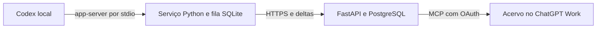

# Codex Vault

Acervo pessoal de conversas do Codex. Cada computador cadastrado lê seu histórico local e sincroniza com um servidor privado. No ChatGPT Work, o plugin oferece busca com referências, navegação, exportação e continuação em um novo rascunho.



## Experimente com dados fictícios

Instale Python 3.12 ou superior e [uv](https://docs.astral.sh/uv/). Em um terminal, na raiz do repositório, execute:

```shell
uv sync --locked --extra dev
uv run cvault init
uv run cvault serve
```

O servidor local usa SQLite e cria seu banco em `.local`. O comando `init` gera a chave do acervo em `.env`.

Em outro terminal, execute `uv run cvault pairing notebook` e forneça o código descartável quando `uv run cvault pair` pedir. Em seguida, experimente todos os passos sem ler seu histórico real:

```shell
uv run cvault pull --device notebook
uv run cvault agent --source examples/sample.json --once
uv run cvault devices
uv run cvault list
uv run cvault search "autenticação"
uv run cvault chats
uv run cvault read ID_DA_CONVERSA --limit 10
uv run cvault export ID_DO_PROJETO
```

## Conecte seus computadores

1. Hospede uma instância para uso pessoal com HTTPS e armazenamento persistente. Defina `VAULT_PUBLIC_URL` para a origem pública, `VAULT_ADMIN_TOKEN` para uma chave aleatória com pelo menos 32 caracteres e `VAULT_DATABASE_URL` para o PostgreSQL. Use `docker compose up --build` com `VAULT_DB_PASSWORD` preenchida com uma senha que possa aparecer em uma URL sem escape. O Compose publica a API em `127.0.0.1:8765` para o seu proxy HTTPS.
2. No computador administrador, configure `.env` com a origem pública e a chave. Use `cvault pairing NOME` para cada máquina. O código vence em 10 minutos.
3. Na máquina de origem, execute `cvault pair --server https://SEU-DOMINIO`. O agente guarda a credencial própria no arquivo de dispositivo. Use `--device-file` se quiser manter perfis separados.
4. Rode `cvault agent` na máquina de origem. O serviço atende pedidos de sincronização enquanto estiver em execução. Acrescente `--sync-every 300` para sincronizar automaticamente a cada cinco minutos.

O coletor usa os métodos de leitura do [Codex app-server](https://learn.chatgpt.com/docs/app-server). Ele consulta conversas armazenadas, incluindo as arquivadas. Use `--workspace NOME` para distinguir workspaces de origem. Para selecionar pastas, use opções repetíveis como `--include "C:/repos/*" --exclude "*/cliente-privado*"`. O filtro vale para envios futuros. O acervo preserva o material já sincronizado.

A sincronização envia mudanças e só avança o estado local após a confirmação do servidor. Um computador offline mantém o pedido pendente. Um job interrompido pode ser retomado após o vencimento da concessão temporária. Para unir pastas de máquinas distintas, compare os identificadores de repositório em `cvault list` e execute `cvault map-projects ID_DESTINO ID_ORIGEM --confirm`. O mapeamento vale para próximas conversas das mesmas origens.

## Conecte ao ChatGPT Work

Em **Plugins → Adicionar servidor MCP personalizado**, informe `https://SEU-DOMINIO/mcp` e escolha OAuth com registro dinâmico. A tela de autorização do próprio acervo pede a chave `VAULT_ADMIN_TOKEN`. O login OAuth usa PKCE e emite tokens do acervo. O SDK do Codex continua usando sua própria autenticação local.

Se o ChatGPT informar um domínio de retorno diferente, confira a URL exibida no seu fluxo de configuração e acrescente apenas esse host em `VAULT_OAUTH_REDIRECT_HOSTS`, uma lista JSON. A configuração padrão aceita `chatgpt.com`, `platform.openai.com` e retornos locais para testes. Use um acervo separado por usuário ou grupo de confiança, pois uma instância é de proprietário único.

Instale o plugin pessoal, abra o modo Work e selecione o **Acervo do Codex** na barra lateral, quando disponível. Também é possível invocar `open_library` pelo chat. A opção **Continuar no ChatGPT** prepara trechos selecionados para um rascunho novo nas superfícies compatíveis. A janela permite revisar e copiar o contexto.

| Ferramenta MCP | O que faz |
| --- | --- |
| `devices` | Exibe status e última sincronização dos dispositivos. |
| `list` | Lista projetos, chats únicos e cobertura. |
| `pull` | Solicita atualização de uma máquina pelo nome ou ID. |
| `pull_all` | Solicita atualização de todas as máquinas e mostra as pendentes. |
| `job_status` | Consulta um pedido, incluindo falha ou resultado. |
| `chats` / `read` | Lista e abre conversas em páginas. |
| `search` | Busca em mensagens com trecho, data e referência. |
| `export` | Retorna links de dez minutos para JSON e Markdown. |
| `continue_context` | Prepara o contexto de uma conversa com referências. |

Leia o fluxo oficial de [conexão de servidores MCP personalizados](https://developers.openai.com/api/docs/guides/custom-mcp-server) e de [extensões para a barra lateral](https://developers.openai.com/plugins/build/extensions).

## Reconstrução experimental de projetos nativos

`cvault reconstruct` aceita um ou mais arquivos JSON de `cvault export`. A execução padrão imprime a lista de projetos e conversas a criar. A opção `--execute` abre um perfil separado do Chromium, espera o login manual e usa um arquivo de seletores Playwright validado para a interface da conta.

```shell
uv sync --locked --extra browser
uv run playwright install chromium
uv run cvault reconstruct .local/exports/ID_DO_PROJETO.json
```

O arquivo passado a `--selectors` precisa declarar `new_project`, `project_name`, `create_project`, `new_chat`, `composer`, `attachment_input`, `attachment_ready` e `send` como seletores. Declare também `project_url_pattern` e `chat_url_pattern` como expressões regulares para confirmar navegação. A fixture em `tests/test_browser.py` serve como exemplo do contrato. Valide os seletores com um projeto de teste antes de usar `--execute` no ChatGPT.

O lote cria projetos e chats novos, anexa cada transcrição Markdown e pede ao ChatGPT um resumo das decisões e pendências. O diário por projeto em `.local/reconstruction` preserva as URLs já criadas e pausa diante de um envio cujo resultado ficou ambíguo. Confira a interface e reconcilie o diário antes de retomar um caso ambíguo. As transcrições preservam referências e os metadados disponíveis na origem.

## Testes

```shell
uv sync --locked --extra dev --extra browser
uv run ruff check
uv run pytest
```

- `VAULT_TEST_BROWSER=1` usa o Chromium do Playwright. Você também pode fornecer o caminho do Chrome. Esses testes cobrem a interface MCP em um host de teste e a reconstrução em uma página simulada.
- `VAULT_TEST_POSTGRES_URL` habilita a suíte contra uma instância PostgreSQL de teste. Cada teste usa um esquema isolado e descartável.
- `VAULT_TEST_REAL_CODEX=1` testa o app-server instalado com uma consulta limitada a uma pasta temporária vazia.

O acervo inclui o histórico disponível no ambiente lido. Datas ausentes, sessões efêmeras e conteúdo que o app-server não expõe ficam fora das garantias. O filtro de segredos cobre padrões comuns e campos sensíveis. Revise a seleção antes de enviar dados privados. Consulte o [escopo](ESCOPO.md) para as distinções entre acervo, continuação e reconstrução.
